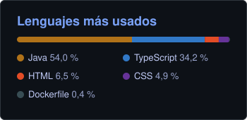

 

  

## Sobre mí

Desarrollador full stack junior en Almendralejo (Badajoz), Técnico Superior en DAM.

Trabajo con **Java y Spring Boot** o **NestJS** en el backend y **Angular, React y TypeScript** en el frontend, casi siempre sobre **PostgreSQL**. Hice prácticas manteniendo aplicaciones en producción y ahora desarrollo software a medida para negocios locales en **RAMABIT**, un proyecto que he cofundado.

**Busco mi primer puesto como desarrollador junior**, presencial en Extremadura, híbrido o en remoto. Me puedes escribir a [raulnugo06@gmail.com](mailto:raulnugo06@gmail.com) o por [LinkedIn](https://www.linkedin.com/in/raulnugo06).

## Proyectos

### [opInA](https://github.com/RaulNuGo06/opina) · Spring Boot + Angular + IA

Opiniones de clientes para negocios locales: el cliente opina desde una tarjeta NFC o un QR y el negocio lo ve en un panel. Claude clasifica cada opinión por tema y urgencia y resume lo que dicen los clientes.

- API REST con Spring Security (JWT) y permisos por rol; migraciones con Flyway.
- Defensa frente a inyección de prompts y salida estructurada del modelo.
- 65 tests con JUnit 5 y Testcontainers, CI en GitHub Actions e imagen Docker lista para desplegar.

Java 21 · Spring Boot 4 · PostgreSQL · Angular 22 · API de Claude · Docker

### [Hueco](https://github.com/RaulNuGo06/hueco) · NestJS + React

Reservas de citas para peluquerías, barberías o fisios: el cliente reserva desde el móvil sin crear cuenta y el dueño ve la agenda del día en un panel.

- Una restricción de exclusión de PostgreSQL impide que dos personas se queden con el mismo hueco, con un test de 10 reservas simultáneas.
- Horarios con jornada partida y zonas horarias, probado en los días de cambio de hora.
- Sesiones con cookie `HttpOnly`, protección CSRF y validación con Zod.
- 47 tests (Vitest, Testing Library y e2e contra PGlite) y una CI que levanta el `docker compose` completo.

NestJS 12 · TypeScript · Drizzle · PostgreSQL · React 19 · TanStack Query · Docker

### [Rivange](https://github.com/RaulNuGo06/Rivange) · Android

App para un complejo deportivo: reservas de pistas, partidos, ranking, chat y datos en tiempo real de una estación meteorológica. Proyecto de fin de ciclo.

Java · Android · Firebase Auth · Firestore · OkHttp · Home Assistant

### Trabajos para clientes · código privado

Con RAMABIT también hago proyectos a medida para negocios locales. El código y los datos son de cada cliente, así que aquí solo cuento de qué van:

- **App de marca blanca para gimnasios:** cada gimnasio la lanza con su marca. Rutinas, entrenos, récords y afluencia para los socios; avisos, incidencias y estadísticas para el gimnasio. Varios gimnasios en una sola base de datos, aislados con RLS de PostgreSQL. React Native · Expo · TypeScript · Supabase
- **Web para un restaurante:** rápida, sin dependencias y con la carta fácil de cambiar. HTML · CSS · JavaScript
- **Propuesta de web para un negocio de lavado y detailing de coches:** servicios, trabajos realizados y cita por WhatsApp, pensada para el móvil.

## Cómo trabajo

- **Tests y CI desde el primer commit.** Cada repositorio tiene su pipeline en GitHub Actions con lint, tests y compilación.
- **Las reglas importantes, también en la base de datos:** restricciones, `CHECK` y migraciones versionadas, por si alguien se salta la API.
- **README que se puede seguir:** cómo arrancarlo con Docker, la cuenta de demostración y por qué tomé cada decisión técnica.

## Experiencia

**Cofundador y desarrollador full stack, RAMABIT** · sep 2026 – actualidad 
Apps y webs para negocios locales con React, TypeScript, Node.js y NestJS. Me encargo del ciclo completo: hablar con el cliente, desarrollar y entregar.

**Desarrollador full stack (prácticas), BlueEnergy S.L.** · mar 2026 – jun 2026 
Nuevas funcionalidades y mantenimiento de aplicaciones web internas: Angular en el frontend, APIs REST con Java y Spring Boot, consultas SQL e incidencias en producción, trabajando con el flujo Git del equipo.

**Formación:** CFGS Desarrollo de Aplicaciones Multiplataforma (2024 – 2026) · CFGM Sistemas Microinformáticos y Redes (2022 – 2024)

## Tecnologías

   
   
  

También: Spring Security (JWT) · Flyway · Drizzle · Zod · TanStack Query · OpenAPI · Docker Compose · nginx · JUnit 5 · Testcontainers · Vitest · Testing Library · Scrum

